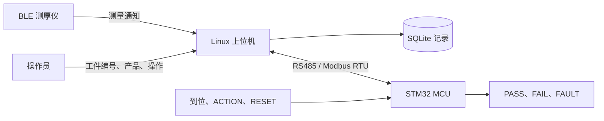
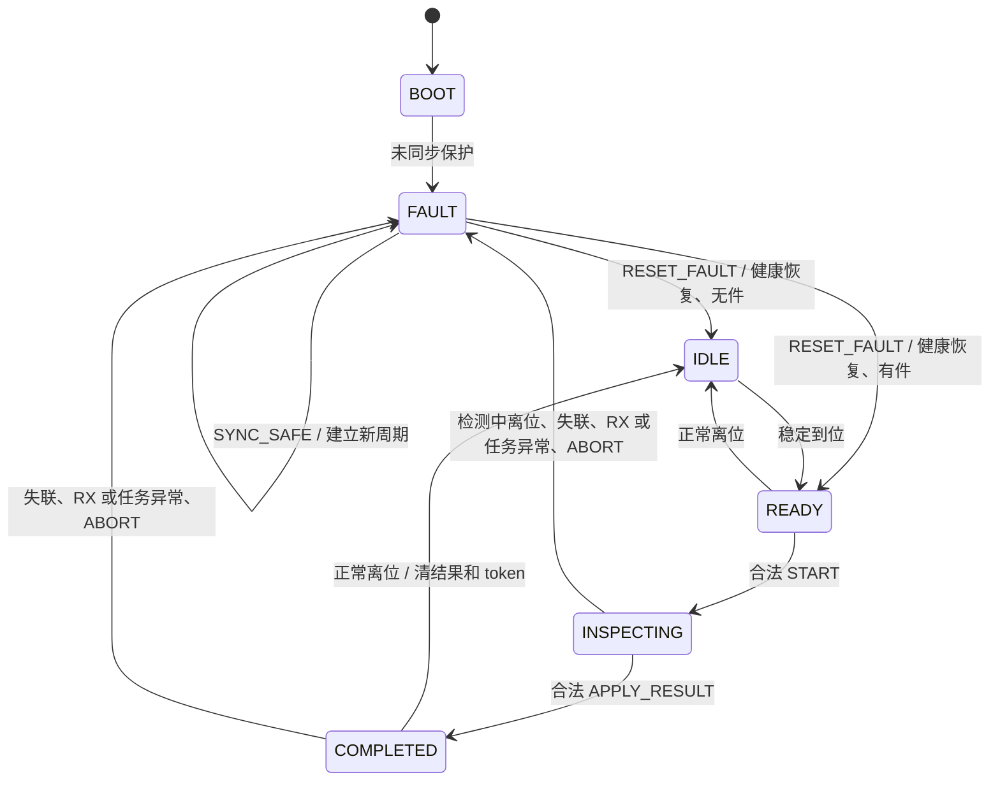

# 项目结构、关键模块与完整流程

依据当前 MCU 固件 1.0.0 源码整理；协议版本 0x0200。本文帮助理解工程、定位代码和阅读上下位机协作流程。

MCU 软件已完成离线构建与自动测试。当前接线是候选配置，`BOARD_WIRING_CONFIRMED=0`；实际板卡、RS485 波形、真实 BLE 仪器、现场保护延迟和真实 24 h 运行尚未验收。上位机行为说明来自项目交接文档及已固定的上游协议契约测试，不能等同于完整上位机实机联调。

## 1. 项目在整个系统中的位置



| 参与方 | 职责 |
|---|---|
| 测厚仪 | 提供厚度、材料等测量数据，通过 BLE 交给上位机 |
| Linux 上位机 | 管理工件和产品规则、BLE 连接、采点窗口、候选确认、质量判定、数据库记录，以及 MCU 命令和事件确认 |
| MCU 下位机 | 读取现场输入、锁存按钮事件、提供工位状态、执行最终结果与撤销命令，并独立处理失联、离位和任务异常 |

MCU 不接 BLE，不保存厚度和产品规则，不自行累计测点，也不接 OneNET。一次 1 点或 5 点检测，对 MCU 都是一个从 START 到 APPLY_RESULT 的任务；采点细节由上位机管理。

`FAIL` 是质量不合格；`FAULT` 是系统或现场异常。BLE 断连、检测中离位等异常不应被解释成质量 FAIL。

## 2. 仓库结构

```text
coating_inspection_mcu/
├─ .gitattributes                 保留文件字节，避免依赖哈希因换行转换改变
├─ .vscode/
│  ├─ settings.json              工程路径与代码索引配置
│  └─ tasks.json                 构建、测试、验证、SWD 烧录任务
├─ Doc/
│  ├─ 01～03                     项目背景及原始实施计划
│  ├─ 04～06                     清理记录、基线记录、实施与协议冻结记录
│  ├─ 07_MCU开发交接文档.md       上位机接口与协作流程原始交接
│  ├─ 08_MCU软件交付与运行说明.md 当前版本配置、协议、操作及诊断
│  ├─ 09_MCU实机验收与已知限制.md 待执行的实机验收清单
│  ├─ 10_MCU离线验证结果.md       上一次实际离线检查报告
│  └─ 11_项目结构与关键流程说明.md 本文
└─ coating_inspection_mcu/
   ├─ Application/              应用任务和工位业务
   │  ├─ app_runtime.c/.h       三任务、命令队列、共享状态提交
   │  └─ Workstation/           纯 C 工位状态机
   ├─ Bsp/                      STM32 硬件驱动和板卡配置
   │  ├─ Board/                 引脚、有效电平、致命故障安全输出
   │  ├─ Reset/                 RCC 复位原因采集
   │  ├─ UART/                  USART1 调试输出与 newlib 接口
   │  ├─ RS485/                 USART2、DMA、微秒计时、DE 收发控制
   │  └─ Watchdog/              IWDG 初始化和喂狗
   ├─ Core/                     main、时钟、GPIO、启动、IRQ、RTOS 入口
   ├─ Device/
   │  ├─ DigitalInput/          输入去抖
   │  └─ Output/                输出策略和实际 GPIO 提交
   ├─ Module/
   │  ├─ Protocol/              字段定义、编解码、CRC、Modbus 服务
   │  ├─ Transport/             RTU 定界、接收记录环、DMA 游标
   │  ├─ Health/                任务进度期限判断
   │  └─ Diagnostics/           诊断队列、复位原因编解码
   ├─ Drivers/                  CMSIS 与 STM32 HAL 依赖
   ├─ Middlewares/              FreeRTOS 内核与 Cortex-M4F 移植
   ├─ cmake/                    工具链、链接脚本、纯 C 共用源码清单
   ├─ tests/                    原生 C/C++ 测试与虚拟工位程序
   │  └─ vendor/host_protocol/  固定版本的上位机协议测试源文件
   ├─ tools/                    固件检查、全量验证、回放、串口 CLI、长稳记录
   ├─ CMakeLists.txt            固件源码与构建配置
   ├─ CMakePresets.json         debug / release / debug-inject
   ├─ STM32F407.ioc             候选 GPIO、芯片与时钟参考
   ├─ README.md                工程入口说明
   ├─ CMAKE_BUILD.md            构建烧录说明
   ├─ check_build_env.py        本机工具链检查
   ├─ validate_m0.py            兼容早期检查入口
   ├─ build/                    普通开发构建产物
   ├─ build-release/            交付固件 ELF / BIN / HEX / MAP
   ├─ build-inject/             显式故障注入版
   ├─ build-host/               本机测试程序
   ├─ build-validation/         验证日志、JSON、JUnit
   └─ delivery/                 固件与源码交付包
```

`build*`、`delivery` 和 Python 缓存被 Git 忽略，构建后生成。源码、配置、依赖、测试和 Doc 文档受版本控制。`.ioc` 仅作参考，工程以手工维护源码、CMake 和 `board_config.h` 为准。

## 3. 分层关系与关键文件

业务状态机、协议、去抖、健康判断和传输算法采用纯 C；它们通过参数获取时间与输入，可同时编译到 MCU 和本机测试。HAL、DMA 寄存器与 FreeRTOS 调度集中在硬件和运行层。

| 文件或模块 | 关键作用 | 阅读关注点 |
|---|---|---|
| [Core/Src/main.c](../coating_inspection_mcu/Core/Src/main.c) | 上电初始化、启动调度器 | 复位原因先采集；GPIO 安全态先建立；之后初始化串口、RS485、IWDG |
| [Application/app_runtime.c](../coating_inspection_mcu/Application/app_runtime.c) | 三任务协作中心 | `CommTask`、`WorkTask`、`HealthTask`、`Commit`、命令队列和快照回调 |
| [Application/Workstation/workstation.c](../coating_inspection_mcu/Application/Workstation/workstation.c) | 工位业务核心 | `WS_Step`、`WS_Protect`、`WS_QueuedCommand`、`WS_Snapshot` |
| [Module/Protocol/protocol.h](../coating_inspection_mcu/Module/Protocol/protocol.h) | 协议常量和结构 | 状态、命令、ACK、故障、超时、命令字段 |
| [Module/Protocol/modbus.c](../coating_inspection_mcu/Module/Protocol/modbus.c) | Modbus 服务 | CRC、功能码、范围和长度验证；FC10 只入队 |
| [Bsp/RS485/bsp_rs485.c](../coating_inspection_mcu/Bsp/RS485/bsp_rs485.c) | 实际串口传输 | RX 环形 DMA、时间记录、接收恢复、TX DMA 与 USART TC |
| [Module/Transport/rtu.c](../coating_inspection_mcu/Module/Transport/rtu.c) | RTU 分帧和软件接收环 | 基于接收时间计算间隔，不能使用任务读取时间分帧 |
| [Device/DigitalInput/debounce.c](../coating_inspection_mcu/Device/DigitalInput/debounce.c) | 三路输入去抖 | 稳定 30 ms 后才改变逻辑输入 |
| [Device/Output/output_manager.c](../coating_inspection_mcu/Device/Output/output_manager.c) | 实际结果输出 | 故障覆盖、PASS/FAIL 互斥、先关再开、有效电平转换 |
| [Module/Health/health.c](../coating_inspection_mcu/Module/Health/health.c) | 任务进度检查 | 通信和健康 300 ms、工位 100 ms 的期限 |
| [Bsp/Board/board_config.h](../coating_inspection_mcu/Bsp/Board/board_config.h) | 板级配置入口 | 引脚、输入输出极性、晶振、IRQ 优先级及接线确认标记 |
| [Bsp/Watchdog/bsp_watchdog.c](../coating_inspection_mcu/Bsp/Watchdog/bsp_watchdog.c) | IWDG | 健康任务条件喂狗，内部异常停止喂狗 |

推荐阅读顺序：`protocol.h → workstation.h/.c → app_runtime.c → modbus.c → rtu.c → bsp_rs485.c → board_config.h`。先理解业务，再进入驱动细节。

## 4. 三个任务如何协作

| 任务 | 调度 / 优先级 | 栈 | 一轮工作 |
|---|---|---:|---|
| HealthTask | 100 ms / 5 | 256 word，1024 B | 检查任务进度、主站心跳及故障；提交安全输出；内部健康时递增 MCU 心跳并喂 IWDG |
| CommTask | 通知唤醒，通常最长等待 10 ms / 4 | 768 word，3072 B | 消费接收记录、RTU 定界、处理 Modbus、命令入队、发送响应、处理发送完成、输出有界诊断 |
| WorkstationTask | 10 ms / 3 | 512 word，2048 B | 采样去抖、产生按钮事件、执行保护、取队列命令、更新状态和输出 |

任务和容量为 8 的命令队列均静态创建。队列存完整命令副本及入队时的安全代次。

`g_workstation` 是共享工位状态，包含状态、token、ACK、按钮事件、心跳、故障门控、命令缓存和诊断计数。共享状态更新及 GPIO 提交在短临界区内完成；快照在临界区内复制，响应编码和串口发送在外部执行。

`Commit()` 调用 OutputManager 将逻辑输出提交到 GPIO，同时生成状态、输出、故障和事件变化日志。HealthTask 可直接提交故障输出；WorkstationTask 的后续普通输出仍须经过相同故障门控。

ISR 负责取数据、记录接收时间和错误、标记发送完成、通知任务。ISR 不执行业务命令，也不格式化日志。CommTask 每轮处理最多 128 条接收记录和 2 条诊断记录，并阻塞至少一个 tick，给工位任务运行机会。

## 5. 通信链路：从字节到现场动作

### 5.1 请求接收路径

```text
主站 RS485 请求
  → USART2 接收
  → RX DMA 512 B 环形区
  → IDLE / DMA HT / DMA TC / TIM3 活动检测
  → 提取新增字节及微秒时间，写软件接收记录环
  → 通知 CommTask
  → RTU 根据字节间隔及静默记录形成完整帧
  → 校验地址、CRC、功能码、长度、寄存器范围
  → FC04 快照 / FC06 心跳 / FC10 完整命令入队
```

软件接收环容量为 1024 条记录，携带数据字节及时间/类型元数据；与 512 B DMA 区分开。TIM2 提供 1 MHz 时间，TIM3 每 50 μs 检查 DMA 活动。RTU 参数为 t1.5=750 μs、t3.5=1750 μs，计算还考虑字符时间与监视余量。

### 5.2 响应发送路径

```text
编码完整响应 → DE 置发送态 → TX DMA
  → DMA 完成，开启 USART TC 中断
  → USART TC 确认最后停止位发送完成
  → DE 回接收态 → 通信任务获知发送成功
```

DMA 完成仅表示数据已交给 UART，USART TC 才代表实际发送完成。只有完整 FC04 响应成功发送，才可能满足按钮重新开放所需的快照条件。

### 5.3 四种功能码

默认从站地址 1，115200、8E1。寄存器高字节先发，32 位字段高字在低地址，CRC 低字节先发。

| 功能码 | 访问 | 用途 |
|---|---|---|
| FC04 | `0x0000～0x0015`，完整快照 22 字 | 读状态、输入、实际输出、故障、健康、MCU 心跳、运行时间、token、ACK、按钮事件和复位原因等 |
| FC06 | 仅 `0x0100` | 写 16 位主站变化心跳 |
| FC10 | 必须 `0x0110` 起一次写 9 字、18 字节 | 提交完整业务命令 |
| FC03 | 心跳单字或命令块连续子区间 | 读回心跳或最近缓存的已处理命令 |

FC10 命令为 `epoch(32) + token(32) + seq(32) + opcode(16) + arg(32)`。命令队列满返回 Modbus 异常 0x06；不得先成功响应再丢命令。广播不执行、不响应。

### 5.4 两次确认的含义

1. FC10 写响应：帧合法，完整命令已进入队列。
2. 后续 FC04：`ACK_EPOCH / ACK_SEQ` 匹配，`ACK_STATUS=1`，且现场状态、token 和输出满足该命令后置条件。

上位机必须完成第二步才可确认业务动作。即使读到历史成功 ACK，也仍须核对当前现场条件。

## 6. 工位状态与命令

| 状态 | 值 | 含义 / 常规输出 |
|---|---:|---|
| BOOT | 0 | 初始化瞬时状态，结果灯关闭 |
| IDLE | 1 | 已复位、无工件，输出 0 |
| READY | 2 | 工件已稳定到位，等待 START，输出 0 |
| INSPECTING | 3 | 已绑定任务，覆盖整个多点检测，输出 0 |
| COMPLETED | 4 | 已执行最终结果，保持 PASS=1 或 FAIL=2 |
| FAULT | 5 | 故障锁存，清 token，结果关闭，FAULT=4 |



图示为主要路径；合法新 SYNC_SAFE、ABORT 和适用的保护条件也可使其他状态进入 FAULT。

| 命令 | 值 | 成功行为及主要条件 |
|---|---:|---|
| SYNC_SAFE | 1 | 接受更大的非零 epoch；清任务、旧事件和结果，进入安全故障态。保留较高优先级故障；不解除输出门控 |
| START | 2 | READY、到位、变化心跳新鲜、全部健康；绑定非零 token，进入 INSPECTING |
| APPLY_RESULT | 3 | INSPECTING、同 token、到位且健康；arg=1/2，进入 COMPLETED 并输出 PASS/FAIL |
| ACK_INPUT_EVENT | 4 | arg 精确匹配待确认事件序号；清事件，不改变检测结果，不要求任务 token 匹配 |
| RESET_FAULT | 5 | 仅 FAULT；token/arg 为 0、原因可解除且健康满足；清门控，按到位进入 IDLE/READY |
| ABORT | 6 | 不依赖新鲜主站心跳；有活动 token 时须匹配；撤销任务和结果，进入 FAULT |

ACK_STATUS：0 无、1 成功、2 状态拒绝、3 token 拒绝、4 身份拒绝、5 健康拒绝、6 参数或命令拒绝。

## 7. epoch、seq、token 和安全代次

| 字段 | 解决的问题 |
|---|---|
| epoch | 区分同步周期，拒绝旧连接周期的命令。上位机建立新周期时分配更大非零值 |
| seq | 区分同周期中的命令，普通新命令严格前进，允许跳号 |
| token | 绑定一件检测，防止其他任务或上一件结果作用于当前工件 |
| safety_generation | MCU 内部区分安全上下文；发生故障或新同步后，使旧队列中的普通命令失效 |

MCU 缓存最近处理的一条合法身份命令及其 ACK。相同 epoch/seq、内容完全一致的重传只发布历史 ACK，不重复执行；同身份不同内容返回身份拒绝，不覆盖原缓存。

合法新序号的业务拒绝也缓存。因此“因无到位而拒绝 START”之后，同一命令重传不会因后来到位而自动执行，须使用新命令身份。

缓存容量是最近一条命令，并非无限历史。更早命令通常由 epoch/seq 前进规则拒绝。无论历史 ACK 如何，故障门控始终禁止恢复旧 PASS。

## 8. 整个正常检测流程

### 8.1 上电、同步、人工复位

1. `main()` 先读取 RCC 复位原因，再初始化 HAL、时钟、GPIO 安全态、USART1、RS485 和 IWDG。
2. 创建静态队列与三个任务，启动 FreeRTOS；未同步保护使工位进入 FAULT，token=0、结果关闭。
3. 上位机读完整快照、核对协议，分配新 epoch，发送 SYNC_SAFE。
4. MCU 清除旧任务和按钮上下文，发布同步 ACK，并保持安全故障态。
5. 上位机继续写变化心跳。SYNC 会清除心跳有效资格，因此必须在新周期再次收到数值变化。
6. 操作员输入上位机 `reset`，或通过物理 RESET 事件提出复位请求；上位机发送 RESET_FAULT。
7. MCU 检查原因可解除、内部健康和新鲜心跳后解除门控：无件进入 IDLE，有件进入 READY。

物理 RESET 是业务按钮。它经上位机解释后发复位命令，按下本身不会直接清故障或复位芯片；NRST 是另一种硬件复位。

### 8.2 创建一件任务

1. 工件到位，三路输入 10 ms 采样、稳定 30 ms 后更新；IDLE 转 READY。
2. 操作员在上位机指定工件和产品，例如 `start MCU-001 demo5`。
3. 上位机检查仪器在线、工位可用、数据库和自身业务条件，创建任务并分配 token。
4. 上位机发送 START；MCU 校验后绑定 token，进入 INSPECTING，结果灯保持关闭。
5. 上位机读到匹配 ACK 和当前状态后进入 WAIT_ARM。

当前 ACTION 按钮不能从 READY 创建任务。创建任务仍由上位机的工件/产品输入和 START 流程完成。

### 8.3 完成每个测点

```text
WAIT_ARM
  → 操作员 arm 或按 ACTION
WAIT_NEW_MEASUREMENT
  → BLE 仪器提供当前窗口的新测量
WAIT_CONFIRM
  → 操作员确认候选或按 ACTION
保存一个确认点
  → 点数未够：回 WAIT_ARM
  → 点数满足：上位机最终判定并提交数据库事务
```

整个循环中 MCU 都保持 INSPECTING，持续检查到位、心跳和内部健康。MCU 上报按钮事件，厚度、候选编号、点数和判定留在上位机。

ACTION 的含义随上位机阶段变化：WAIT_ARM 开窗口，WAIT_CONFIRM 确认候选，WAIT_NEW_MEASUREMENT 中不会成为有效采点操作，但事件仍需 ACK 清除。候选绑定由上位机快照处理上下文确定；协议没有按钮时间戳与候选编号字段。

### 8.4 最终结果和下一件

1. 上位机确认全部测点，按规则判定 PASS/FAIL并保存最终事务。
2. 上位机发送 APPLY_RESULT，携带当前 token 和 arg=1/2。
3. MCU 检查当前仍为 INSPECTING、token 一致、到位及健康，进入 COMPLETED 并点亮对应结果。
4. 上位机用后续完整快照确认实际输出。
5. 工件正常离位：MCU 清结果和 token，进入 IDLE。
6. 下一件到位进入 READY，由上位机创建新 token 开始新的任务。

正常连续生产中不需要每件重新 SYNC/RESET。若结果命令拒绝或超时，上位机保留已落库的质量结果，另记录现场执行 UNKNOWN/FAILED，并进入异常处理；数据库 PASS 不代表现场输出已确认。

## 9. 按钮事件为什么要锁存

上位机采用轮询读状态，短按可能发生在两次轮询之间。因此 MCU 保存事件，直到主站明确确认。

```text
原始按键
  → 30 ms 去抖
  → 按下沿生成 EVENT_SEQ / EVENT_CODE
  → 即使松开，多次快照仍读到同一事件
  → 主站按事件序号去重并处理业务
  → ACK_INPUT_EVENT 精确确认
  → EVENT_CODE 清零，发布对应成功 ACK
  → 完整成功 ACK + 空事件 FC04 响应发送成功
  → 自 ACK 执行起至少 1200 ms，且两按钮均稳定释放
  → 允许下一事件
```

仅一个待确认事件，长按不重复生成。占用或保持期的新按键丢弃并计忙碌，不缓存、不覆盖。两个按钮同周期按下时 ACTION 优先，RESET 计忙碌。

保持期是为兼容现有主站 `EVENT_CODE=0` 确认条件而采用的限制。连续 arm/confirm 操作须留足时间；不能以快速连按方式积攒事件。

## 10. 异常保护与恢复

| 异常 | 检测方式 | MCU 动作 |
|---|---|---|
| 主站失联或重复相同心跳 | 最近一次变化心跳达到 1500 ms；新同步后一直无有效变化也有期限 | 清 token 和结果、锁存 FAULT；内部任务健康仍喂狗 |
| 检测中离位 | 到位经去抖失效，工位周期处理 | 撤销任务和结果，进入 FAULT |
| 完成后正常离位 | COMPLETED 下到位失效 | 清结果和 token，进入 IDLE |
| RX 严重异常 | UART/DMA 错误、接收环溢出、时间信息不可可靠恢复 | 清受影响帧并恢复接收；检测或保持结果期间进入 FAULT |
| 通信/工位/健康任务停滞 | 正常循环进度超出 300/100/300 ms | 剩余运行路径置安全故障输出；内部异常停止条件喂狗，IWDG 恢复 |
| 栈溢出、分配失败、CPU 致命异常 | FreeRTOS 钩子和异常处理 | 尽可能关闭结果、置 FAULT、DE 回接收，停止执行，由已启动的 IWDG 恢复 |
| 上位机主动中止 | 合法 ABORT | 清任务和结果，进入主动撤销故障态 |

主站心跳仅“数值变化”续期；FFFF→0000 是有效变化。IWDG 配置名义约 3 s，实际由 LSI 频率决定。

故障优先级为：任务异常 > RX > 检测离位 > 主站超时 > 主站撤销 > 未同步。另保存首故障原因、时间和当时 token，便于解释后续升级。

恢复流程：

```text
排除异常原因
  → 通信重连 / MCU 重启时重新 SYNC_SAFE
  → 新周期收到变化心跳，内部健康恢复
  → 人工 RESET_FAULT
  → IDLE / READY
  → 创建新任务
```

主动 ABORT 后可沿当前 epoch 等待人工复位。恢复通信、重新到位或重传旧结果都不会自动恢复 PASS；内部故障仍存在时 RESET 会拒绝。

## 11. 如何开发、检查和定位问题

从外层目录进入固件工程后执行：

```powershell
cd coating_inspection_mcu
python tools/validate_project.py
```

一键流程会构建 debug、release、debug-inject，运行本机 C/C++ CTest、协议契约和虚拟回放，检查固件格式、依赖哈希、普通 SRAM 缓冲、注入隔离，并生成交付包与报告。

| 入口 | 用途 |
|---|---|
| `cmake --preset release`，`cmake --build --preset release --parallel` | 单独构建交付固件，注入关闭 |
| `.vscode/tasks.json` | 普通构建、原生测试、全量验证、ST-Link/CMSIS-DAP 烧录 |
| `tools/mcu_cli.py` | 真实串口手动读快照、写心跳和发送命令 |
| `tools/offline_replay.py` + `tests/mcu_emulator.c` | 无硬件的独立进程虚拟回放 |
| `tools/hardware_soak.py` | 有硬件时记录真实串口运行时长及结果 |
| USART1 日志 | 启动、时钟、状态、命令身份、拒绝、首故障、输出撤销、栈水位 |
| SWD 变量 | `g_workstation`、`g_task_cycles`、`g_stack_watermark` 及丢弃计数 |

debug 和 release 均关闭故障注入，只有 debug-inject 显式开放 USART1 的输入替代、任务暂停和 RX 故障入口。日志有界且非阻塞，拥塞时丢弃并计数。

上一次离线报告为三个构建通过、8/8 CTest 通过，包含 100000 随机 ADU、1000 次保护/结果交错、10000 次虚拟闭环及真实上游协议函数契约。具体证据见 [10_MCU离线验证结果.md](10_MCU离线验证结果.md)；这些是既有验证记录，本次整理文档未重新运行构建。

需要改接线时先看 `board_config.h` 与 GPIO 初始化；改业务先看 `workstation.c`；改寄存器先看 `protocol.h`、`WS_Snapshot`、`modbus.c` 并核对主站契约；改通信时序先看 `rtu.c` 与 `bsp_rs485.c`。完整寄存器表和诊断码见 [08_MCU软件交付与运行说明.md](08_MCU软件交付与运行说明.md)，实机项目见 [09_MCU实机验收与已知限制.md](09_MCU实机验收与已知限制.md)。
