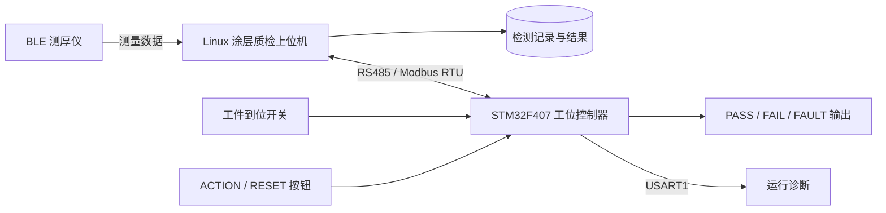
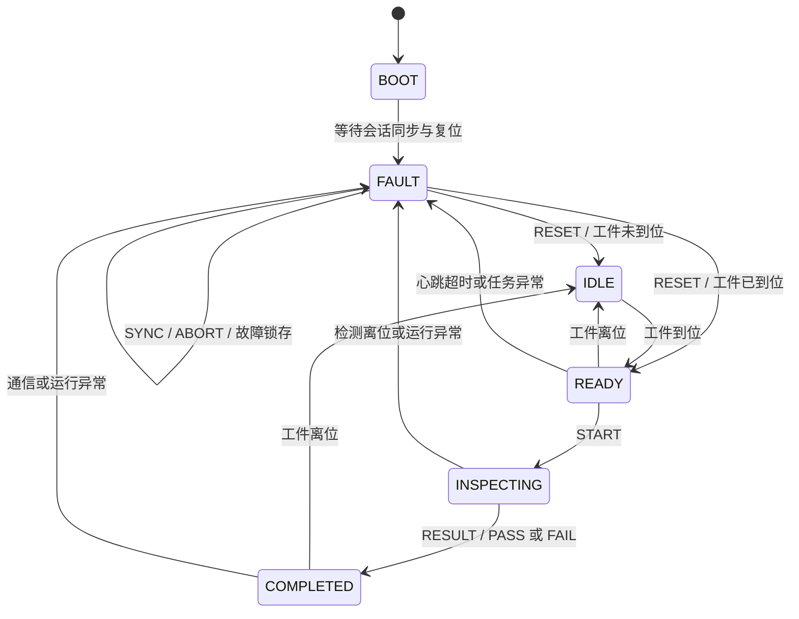

# 工业涂层质检工位控制器

基于 **STM32F407 / FreeRTOS / Modbus RTU** 的涂层质检 MCU 固件，为检测工位提供工件到位采集、操作按钮事件、检测状态管理、PASS / FAIL 输出、通信保护和运行诊断。

本项目与 Linux 涂层质检上位机配套使用：上位机负责测厚仪数据采集、检测任务、质量判定和数据记录；MCU 负责现场输入输出与工位控制。双方通过 RS485 交换状态、按钮事件、控制命令和执行反馈。

**配套上位机仓库：[yz-0609/coating_inspection_host](https://github.com/yz-0609/coating_inspection_host)**

| 项目 | 配置 |
|---|---|
| 固件版本 | `1.0.0` |
| 协议版本 | `0x0200` |
| 主控芯片 | STM32F407VET6，ARM Cortex-M4F |
| 系统时钟 | HSE 25 MHz，SYSCLK 168 MHz |
| 实时系统 | FreeRTOS 10.3.1 |
| 外设驱动 | STM32F4 HAL v1.8.2 / CMSIS |
| 通信接口 | RS485 / USART2，Modbus RTU 从站 |
| 默认串口参数 | 从站地址 `1`，`115200`，`8E1` |
| 开发与构建 | C99、GNU Arm GCC、CMake、Ninja、VS Code |

## 阅读导航

- [项目定位与系统架构](#项目定位与系统架构)
- [核心功能](#核心功能)
- [检测流程与状态机](#检测流程与状态机)
- [软件架构与任务协作](#软件架构与任务协作)
- [项目目录](#项目目录)
- [快速开始](#快速开始)
- [固件烧录](#固件烧录)
- [默认板级配置](#默认板级配置)
- [通信协议](#通信协议)
- [运行保护与诊断](#运行保护与诊断)
- [开发工具与自动测试](#开发工具与自动测试)
- [配套上位机与文档](#配套上位机与文档)
- [第三方组件](#第三方组件)

## 项目定位与系统架构

涂层质检工位需要把测量流程与现场操作协调起来：工件是否到位、操作员是否确认测点、检测是否开始、结果应如何输出，以及通信异常时如何撤销结果。本项目将这些现场控制职责集中在 MCU 中，并通过固定寄存器协议与上位机协作。



| 系统角色 | 主要职责 |
|---|---|
| 测厚仪 | 提供涂层厚度、基材类型和测量信息 |
| Linux 上位机 | 连接仪器，管理工件与测点，执行质量判定，保存数据并发送工位命令 |
| STM32 MCU | 采集现场信号，维护工位状态，确认命令执行，控制结果输出与故障保护 |
| 操作员 | 放置工件，通过按钮配合检测与点位确认 |

上位机的实现与使用说明见 [coating_inspection_host](https://github.com/yz-0609/coating_inspection_host)。

## 核心功能

- **工位状态管理**：维护启动、空闲、就绪、检测中、完成和故障六种状态，按工件到位、业务命令和运行健康条件推进流程。
- **现场输入处理**：周期采样工件到位、ACTION、RESET 三路输入，执行 30 ms 去抖；按钮按下沿生成带序号的事件。
- **按钮事件确认**：事件持续锁存，直到上位机确认；结合响应发送确认、1200 ms 保持时间和按钮释放条件控制下一次触发。
- **检测结果输出**：控制 PASS、FAIL、FAULT，保证 PASS / FAIL 互斥，故障覆盖结果；切换结果时先关闭原输出，再开启新输出。
- **Modbus RTU 服务**：支持 FC03、FC04、FC06、FC10，提供状态快照、心跳写入、完整业务命令和最近处理命令回读。
- **命令身份与重传处理**：使用 `epoch / seq / token` 关联会话、命令和检测任务，缓存最近命令结果，处理重复发送及身份冲突。
- **通信传输**：采用 USART2 环形 RX DMA、TX DMA、接收时间记录和 RTU 分帧，发送结束时通过 USART TC 控制 RS485 方向。
- **运行保护**：处理主站心跳超时、检测离位、接收故障、任务停滞和主动撤销，联动故障输出与独立看门狗。
- **诊断与调试**：提供复位原因、通信错误计数、状态变化、命令反馈、栈水位和调试串口日志。
- **自动化开发流程**：提供三种固件构建预设、原生 C/C++ 测试、协议契约测试、工位回放、固件检查与交付打包脚本。

## 检测流程与状态机

典型流程如下：

1. 上位机通过 `SYNC` 建立新的通信会话。
2. 上位机持续更新变化心跳，并通过 `RESET` 解除工位故障锁存。
3. 工件到位后，MCU 进入 `READY`。
4. 上位机发送携带任务 `token` 的 `START`，MCU 确认条件后进入 `INSPECTING`。
5. 操作员按下 ACTION，MCU 锁存按钮事件；上位机完成业务处理后发送 `ACK_EVENT`。
6. 上位机完成测量判定，发送 `RESULT`，MCU 进入 `COMPLETED` 并输出 PASS 或 FAIL。
7. 完成后的工件离位，MCU 清除任务标识和结果输出，回到 `IDLE`。



图中展示主要业务路径。`SYNC`、`ABORT` 和保护逻辑还会根据当前会话及运行条件更新故障状态。FAULT 恢复由明确的 `RESET` 命令推进；心跳恢复或工件重新到位后，历史结果不会自动重新输出。

| 状态 | 数值 | 含义 |
|---|---:|---|
| `BOOT` | 0 | 启动初始化 |
| `IDLE` | 1 | 等待工件到位 |
| `READY` | 2 | 工件在位，等待开始检测 |
| `INSPECTING` | 3 | 当前任务检测中 |
| `COMPLETED` | 4 | 检测完成并保持结果 |
| `FAULT` | 5 | 故障锁存，等待恢复条件和复位命令 |

## 软件架构与任务协作

工程按启动与外设、板级驱动、设备逻辑、通用模块和应用业务分层。工位状态机、去抖、输出策略、Modbus 和 RTU 逻辑使用纯 C 实现，MCU 固件与原生测试共用同一份模块构建清单。

| 层级 | 目录 | 职责 |
|---|---|---|
| 启动与系统 | `Core/` | 启动向量、主函数、时钟、IRQ、HAL 与 RTOS 入口 |
| 板级驱动 | `Bsp/` | GPIO 配置、UART、RS485、复位原因、IWDG |
| 设备逻辑 | `Device/` | 数字输入去抖、输出策略与 GPIO 提交 |
| 通用模块 | `Module/` | 协议编解码、Modbus 服务、RTU 传输、健康与诊断 |
| 应用业务 | `Application/` | 工位状态机、命令调度、状态提交和任务协作 |

三个 FreeRTOS 任务均使用静态资源创建：

| 任务 | 周期 / 唤醒方式 | 优先级 | 静态栈 | 主要工作 |
|---|---|---:|---:|---|
| `CommTask` | 通知唤醒，最长等待 10 ms | 4 | 768 word | 接收、分帧、Modbus 应答、命令入队、诊断发送 |
| `WorkstationTask` | 10 ms | 3 | 512 word | 输入采样、去抖、状态推进、命令执行与输出提交 |
| `HealthTask` | 100 ms | 5 | 256 word | 任务进度检查、MCU 心跳、栈水位与条件喂狗 |

栈单位为 32 位 word。业务命令队列容量为 8，保存完整命令和安全代次。状态、ACK、按钮事件和 GPIO 输出在统一的短临界区内提交；快照编码、串口发送和日志格式化使用状态副本或在临界区外执行。

新会话或故障会推进安全代次，使旧队列命令失效，避免历史请求在条件变化后再次操作现场输出。

## 项目目录

```text
coating_inspection_mcu/             Git 仓库根目录
├─ README.md                       项目介绍与使用入口
├─ .vscode/                        工作区设置、构建和烧录任务
├─ Doc/                            项目设计、协议与开发文档
└─ coating_inspection_mcu/          MCU 代码工程
   ├─ Application/                 应用调度与工位状态机
   ├─ Bsp/                         板级配置、串口、RS485、看门狗
   ├─ Core/                        启动、时钟、IRQ、RTOS 入口
   ├─ Device/                      输入去抖与输出管理
   ├─ Drivers/                     STM32 HAL 与 CMSIS
   ├─ Middlewares/                 FreeRTOS
   ├─ Module/                      协议、传输、健康与诊断模块
   ├─ cmake/                       工具链、链接脚本、共用模块清单
   ├─ tests/                       原生测试与工位模拟程序
   ├─ tools/                       CLI、回放、监测、校验与打包工具
   ├─ CMakeLists.txt               固件构建入口
   ├─ CMakePresets.json            debug / release / debug-inject
   ├─ CMAKE_BUILD.md               详细构建与烧录说明
   ├─ check_build_env.py           构建环境检查
   └─ STM32F407.ioc                芯片、GPIO 与时钟配置参考
```

仓库根目录用于展示和打开 VS Code 工作区；下文构建、测试、烧录及工具命令均在内部代码目录执行。

## 快速开始

### 1. 准备工具

| 工具 | 要求 / 用途 |
|---|---|
| CMake | 3.21 或以上，配置与构建 |
| Ninja | 构建执行器 |
| GNU Arm Embedded 工具链 | `arm-none-eabi-gcc`、`objcopy`、`size`、`nm`、`readelf` |
| Python | 3.10 或以上，环境检查、校验、回放与开发工具 |
| 原生 GCC / G++ | 构建本机测试和工位模拟程序 |
| OpenOCD | 使用 ST-Link / CMSIS-DAP 烧录时使用 |
| pyserial | 使用串口 CLI 和持续监测工具时使用 |

将工具加入 `PATH`。在仓库根目录进入代码工程并检查环境：

```powershell
cd coating_inspection_mcu
python check_build_env.py
```

### 2. 构建固件

```powershell
cmake --preset release
cmake --build --preset release --parallel
```

| 预设 | 输出目录 | 故障注入 | 用途 |
|---|---|---|---|
| `debug` | `build/` | 关闭 | 默认开发构建 |
| `release` | `build-release/` | 关闭 | 固件交付与默认烧录 |
| `debug-inject` | `build-inject/` | 开启 | 输入和任务异常调试 |

其他变体将命令中的 `release` 替换为对应预设名称。三个预设分别保存构建缓存与产物。

产物名称保留芯片工程标识：

```text
build-release/
├─ STM32F407.elf                    调试与烧录文件
├─ STM32F407.bin                    二进制固件
├─ STM32F407.hex                    Intel HEX 固件
├─ STM32F407.map                    链接与内存分布
└─ compile_commands.json            编译数据库
```

### 3. 运行原生测试

```powershell
cmake -S tests -B build-host -G Ninja -DCMAKE_C_COMPILER=gcc -DCMAKE_CXX_COMPILER=g++
cmake --build build-host --parallel
ctest --test-dir build-host --output-on-failure
```

主机测试工程独立配置，使用本机编译器。Python 解释器可通过 `-DPython3_EXECUTABLE=<Python可执行文件路径>` 显式指定。

### 4. 全量验证与交付打包

```powershell
python tools/validate_project.py
```

脚本依次完成三个固件变体的全量构建、原生测试构建、CTest、工位回放、固件格式检查、第三方来源校验和交付打包。

| 输出位置 | 内容 |
|---|---|
| `build-validation/` | 构建日志、JUnit 测试结果、汇总 JSON 和回放记录 |
| 各固件构建目录下的 `firmware-validation.json` | 固件版本、产物哈希、内存、启动向量与注入配置检查 |
| `delivery/firmware-1.0.0/` | 固件、操作文档、校验报告及 `SHA256SUMS.json` |
| `delivery/firmware-1.0.0.zip` | 固件交付压缩包 |
| `delivery/source-1.0.0.zip` | 源码、依赖、测试、工具与工作区配置压缩包 |

### 5. 使用 VS Code

打开外层 Git 仓库目录，工作区会将 CMake 源目录指向内部 `coating_inspection_mcu/`。按 `Ctrl+Shift+B` 执行默认开发构建；通过“运行任务”选择交付版构建、故障注入版构建、主机测试、回放、全量验证或 SWD 烧录。

构建目录和交付目录已由工程的 `.gitignore` 排除，源码、配置、工具和文档可直接纳入 Git 管理。

## 固件烧录

使用 SWD 连接调试器与目标板：SWDIO、SWCLK、GND、目标电压参考，以及按需连接 NRST。默认烧录任务使用 `release` 固件，并先执行对应构建。

ST-Link：

```powershell
openocd -f interface/stlink.cfg -c "transport select hla_swd" -f target/stm32f4x.cfg -c "adapter speed 1000" -c "program {build-release/STM32F407.elf} verify reset exit"
```

CMSIS-DAP：

```powershell
openocd -f interface/cmsis-dap.cfg -c "transport select swd" -f target/stm32f4x.cfg -c "adapter speed 1000" -c "program {build-release/STM32F407.elf} verify reset exit"
```

更完整的构建、清理、烧录和内存配置说明见 [CMAKE_BUILD.md](coating_inspection_mcu/CMAKE_BUILD.md)。

## 默认板级配置

引脚、有效电平、晶振与中断优先级集中定义在 [board_config.h](coating_inspection_mcu/Bsp/Board/board_config.h)。适配不同板卡时，以该文件和实际板卡原理图为配置入口。

| 功能 | 资源 / 引脚 | 默认配置 |
|---|---|---|
| 工件到位 | PA0 | 高有效，内部下拉 |
| ACTION 按钮 | PA1 | 低有效，内部上拉 |
| RESET 按钮 | PA4 | 低有效，内部上拉 |
| PASS 输出 | PB2 | 低有效，高电平关闭 |
| FAIL 输出 | PC5 | 低有效，高电平关闭 |
| FAULT 输出 | PC2 | 高有效，低电平关闭 |
| RS485 方向控制 | PB1 | 低接收，高发送 |
| RS485 串口 | USART2，PA2 / PA3 | 115200，8E1 |
| 调试串口 | USART1，PA9 / PA10 | 115200，8N1 |
| RX DMA | DMA1 Stream5 Channel4 | 512 B 环形缓冲 |
| TX DMA | DMA1 Stream6 Channel4 | 普通发送模式 |
| 接收时间戳 | TIM2 | 1 MHz，32 位计数 |
| 接收活动监视 | TIM3 | 50 μs 周期 |
| HAL / FreeRTOS 时基 | TIM6 / SysTick | 1 ms |
| 独立看门狗 | IWDG | 标称约 3 s，具体时长由 LSI 频率决定 |

GPIO 初始化前先写入关闭电平。DMA 缓冲使用普通 SRAM；链接脚本配置 Flash 512 KiB、RAM1 112 KiB、RAM2 16 KiB，主栈顶为 `0x2001C000`。

`.ioc` 用于芯片、GPIO 和时钟参考；工程维护以 CMake、板级配置及手工源代码为准。

## 通信协议

### 传输约定

| 项目 | 约定 |
|---|---|
| 总线 / 角色 | RS485，MCU 为 Modbus RTU 从站 |
| 从站地址 | `1` |
| 串口格式 | `115200 / 8E1` |
| 状态快照 | FC04，起始地址 `0x0000`，完整长度 22 个寄存器 |
| 主站心跳 | FC06，地址 `0x0100`，16 位变化值 |
| 业务命令 | FC10，起始地址 `0x0110`，一次写入 9 个寄存器 |
| 命令回读 | FC03，心跳或最近已处理命令寄存器 |
| 字节序 | 寄存器内高字节在前；32 位字段高字在低地址 |
| CRC | CRC16，初值 `0xFFFF`，多项式 `0xA001`，低字节先发送 |
| RTU 时间参数 | `t1.5 = 750 μs`，`t3.5 = 1750 μs` |

### 状态寄存器

完整 FC04 快照包含工位状态、逻辑输入输出、任务身份、命令确认、按钮事件及诊断字段：

| 地址 | 字段 | 含义 |
|---|---|---|
| `0x0000` | `STATE` | 工位状态，取值 0～5 |
| `0x0001` | `INPUT_FLAGS` | bit0 到位、bit1 ACTION、bit2 RESET |
| `0x0002` | `OUTPUT_FLAGS` | PASS=1、FAIL=2、FAULT=4，关闭=0 |
| `0x0003` | `FAULT_CODE` | 当前故障原因 |
| `0x0004` | `HEALTH_MASK` | bit0 Comm、bit1 Work、bit2 Health，正常值 7 |
| `0x0005` | `MCU_HEARTBEAT` | 正常内部健康检查计数 |
| `0x0006～0x0007` | `UPTIME` | 本次启动运行毫秒数，32 位 |
| `0x0008～0x0009` | `TOKEN` | 当前检测任务标识，32 位 |
| `0x000A～0x000B` | `ACK_SEQ` | 最近处理命令序号，32 位 |
| `0x000C` | `ACK_STATUS` | 业务处理结果 |
| `0x000D～0x000E` | `INPUT_EVENT_SEQ` | 按钮事件序号，32 位 |
| `0x000F` | `EVENT_CODE` | 无事件=0、ACTION=1、RESET=2 |
| `0x0010` | `RESET_REASON` | 上电、引脚、软件、看门狗等复位原因位标志 |
| `0x0011～0x0012` | `COMM_ERROR_COUNT` | 通信错误累计，32 位饱和计数 |
| `0x0013` | `PROTOCOL_VERSION` | 协议版本 `0x0200` |
| `0x0014～0x0015` | `ACK_EPOCH` | 最近处理命令的会话标识，32 位 |

### 业务命令

FC10 命令布局为：`epoch_H / epoch_L / token_H / token_L / seq_H / seq_L / opcode / arg_H / arg_L`。

| 命令 | opcode | 用途 |
|---|---:|---|
| `SYNC` | 1 | 建立新的会话，清除当前任务和事件内容，进入故障锁存 |
| `START` | 2 | 携带非零任务 token，开始检测 |
| `RESULT` | 3 | 提交当前任务结果，arg=1 为 PASS，arg=2 为 FAIL |
| `ACK_EVENT` | 4 | 确认锁存按钮事件，arg 为事件序号 |
| `RESET` | 5 | 恢复条件满足时解除故障，进入 IDLE 或 READY |
| `ABORT` | 6 | 撤销任务并进入故障状态 |

`epoch` 区分通信会话，`seq` 区分命令，`token` 关联检测任务。新 SYNC 使用更大的非零 epoch；同一会话的普通命令使用递增的非零 seq。最近一次相同命令重传复用缓存结果；相同身份但内容不同的命令会被拒绝。

FC10 应答确认的是命令写入与入队。上位机随后读取状态快照，匹配 `ACK_EPOCH / ACK_SEQ`，检查 `ACK_STATUS`，再结合状态、token 和输出确认业务执行结果。

| ACK_STATUS | 含义 |
|---:|---|
| 0 | 无确认 |
| 1 | 成功 |
| 2 | 状态不满足 |
| 3 | 任务 token 不匹配 |
| 4 | epoch / seq 身份不合法 |
| 5 | 运行健康条件不满足 |
| 6 | 参数或命令不合法 |

协议常量与字段定义见 [protocol.h](coating_inspection_mcu/Module/Protocol/protocol.h)，寄存器服务见 [modbus.c](coating_inspection_mcu/Module/Protocol/modbus.c)。

## 运行保护与诊断

### 保护策略

- **变化心跳**：主站心跳值变化时刷新有效时间；重复写入相同值不续期。默认超时阈值为 1500 ms。
- **工件离位处理**：检测中离位进入故障；就绪或完成后离位清除任务与结果，返回空闲。
- **任务进度检查**：CommTask、HealthTask 的进度期限为 300 ms，WorkstationTask 为 100 ms。
- **条件喂狗**：HealthTask 完成检查且内部任务健康时喂 IWDG，任务异常时停止喂狗。
- **故障锁存**：故障清除需要恢复条件与 RESET；FAULT 覆盖 PASS / FAIL。
- **接收恢复**：UART / DMA 错误及接收记录异常会清理受影响帧并执行接收恢复。
- **发送方向管理**：TX DMA 完成后等待 USART TC，最后一个停止位发送完成后释放 RS485 DE。

故障码包括心跳超时、检测离位、接收异常、任务异常、主动撤销和未同步。状态机同时保留首发故障时间与任务标识，便于分析异常发生过程。

### 调试日志

USART1 使用有界缓冲和非阻塞发送，输出格式示例：

```text
v=1.0.0 t=123 code=3 a=7 b=4 c=196609
```

日志覆盖启动、状态切换、成功或拒绝命令、故障、输出变化、接收异常、栈水位、时钟配置、命令参数和按钮事件。通过 SWD 可观察 `g_workstation`、`g_task_cycles` 和 `g_stack_watermark`。

`debug-inject` 预设额外启用 USART1 文本调试入口，例如：

```text
inputs 1
inputs auto
pause work 1
pause work 0
rx_fault 1
rx_fault 0
diag
```

普通 debug 和 release 构建关闭这些输入与故障注入入口。

## 开发工具与自动测试

### 自动测试覆盖

原生测试直接编译生产使用的纯 C 模块，同时接入上位机 C++ 协议函数，检查双方的编解码与命令确认约定。

| 测试 | 主要覆盖 |
|---|---|
| `reset_reason` | 复位原因编码和组合 |
| `modbus` | CRC、功能码、寄存器范围、异常响应和协议向量 |
| `workstation` | 工位状态、命令身份、重传、拒绝和安全代次 |
| `inputs_health` | 输入去抖、按钮确认、心跳及计时回绕 |
| `transport` | RTU 分帧、接收环与 DMA 游标 |
| `pressure` | 随机 ADU、保护与结果交错、虚拟工位循环 |
| `upstream_host_contract` | 上位机协议编解码与命令确认契约 |
| `offline_replay` | 独立模拟进程中的完整命令和状态回放 |

压力用例包含 100000 个随机 ADU、1000 次保护与结果提交交错，以及 10000 次虚拟工位流程。测试结果可通过 CTest 查看，全量检查脚本同时生成 JUnit 和 JSON 记录。

### 工位回放

Windows：

```powershell
python tools/offline_replay.py --emulator build-host/mcu_emulator.exe --output build-host/offline-replay.json
```

Linux 使用 `build-host/mcu_emulator`。模拟程序使用虚拟时间推进生产状态机，便于重复分析会话同步、按钮确认、结果输出与故障恢复。

### 串口命令工具

安装串口工具依赖后，可读取快照、写入心跳或发送业务命令：

```powershell
python -m pip install -r tools/requirements.txt
python tools/mcu_cli.py --port COM3 snapshot
python tools/mcu_cli.py --port COM3 heartbeat 1
```

将 `COM3` 替换为实际串口；Linux 可使用 `/dev/ttyUSB0` 或 `/dev/serial/by-id/...`。业务操作支持 `sync / reset / start / pass / fail / ack / abort`，通过 `--epoch`、`--seq`、`--token` 和事件参数关联请求。

CLI 每次执行一条操作。持续检测时由上位机维护变化心跳；同一 RS485 总线使用一个活动主站。

### 持续串口监测

```powershell
python tools/hardware_soak.py --port COM3 --hours 24 --output build-validation/serial-monitor.json
```

监测工具周期写入变化心跳并读取状态，记录实际运行时间、快照数量、通信错误、观察到的复位和状态分布，同时输出 JSON 汇总与 JSONL 采样记录。运行期间由该工具作为总线主站。

### 单独检查固件

```powershell
python tools/validate_firmware.py --build-dir build-release --expected-injection 0
python tools/validate_firmware.py --build-dir build-inject --expected-injection 1
```

检查内容包括 ELF / BIN / HEX 一致性、HEX 校验、启动向量、ARM ABI、未解析符号、DMA 缓冲位置、第三方文件哈希和故障注入配置。

## 配套上位机与文档

配套上位机使用 C++17 / Linux，实现 BLE 测厚仪接入、检测任务与点位管理、质量判定、SQLite 记录、RS485 工位通信和命令确认。

- [上位机仓库与快速开始](https://github.com/yz-0609/coating_inspection_host)
- [上位机协议定义](https://github.com/yz-0609/coating_inspection_host/blob/main/coating_inspection_host/include/inspection/protocol.hpp)
- [上位机协议编解码与命令确认](https://github.com/yz-0609/coating_inspection_host/blob/main/coating_inspection_host/src/workstation/protocol.cpp)

本仓库的文档入口：

| 文档 | 内容 |
|---|---|
| [项目结构与关键流程说明](Doc/11_项目结构与关键流程说明.md) | 目录、关键代码入口、任务关系与业务流程 |
| [构建、测试与烧录](coating_inspection_mcu/CMAKE_BUILD.md) | 构建预设、原生测试、OpenOCD 和产物说明 |
| [整体项目计划](Doc/01_整体项目计划说明书.md) | 系统角色、需求与项目规划 |
| [MCU 实施计划](Doc/03_MCU具体实施计划书.md) | MCU 功能划分与实施安排 |
| [协议冻结记录](Doc/06_MCU实施与协议冻结记录.md) | 通信与固件实现约定 |
| [MCU 开发交接](Doc/07_MCU开发交接文档.md) | 上下位机协作和开发说明 |

## 第三方组件

工程保留 STM32 HAL、CMSIS 和 FreeRTOS 的原始版权及许可证文件。组件说明见 [HAL LICENSE](coating_inspection_mcu/Drivers/STM32F4xx_HAL_Driver/LICENSE.txt)、[CMSIS LICENSE](coating_inspection_mcu/Drivers/CMSIS/LICENSE.txt) 和 [FreeRTOS LICENSE](coating_inspection_mcu/Middlewares/Third_Party/FreeRTOS/Source/LICENSE)。

HAL 文件来源与哈希记录见 [M0_VENDOR_MANIFEST.json](coating_inspection_mcu/Drivers/STM32F4xx_HAL_Driver/M0_VENDOR_MANIFEST.json)。上位机协议测试文件的来源、固定提交和哈希记录见 [PROVENANCE.json](coating_inspection_mcu/tests/vendor/host_protocol/PROVENANCE.json)。
