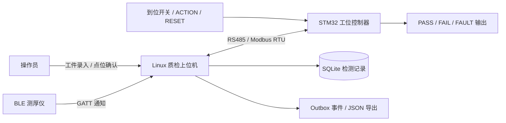
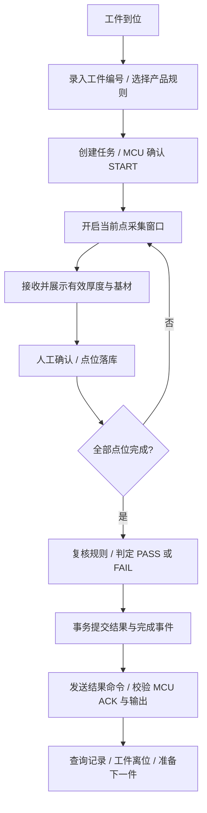

# 工业涂层质检与工位协同系统

**上下位机独立仓库：** [Linux 上位机](https://github.com/yz-0609/coating_inspection_host) · [STM32 下位机](https://github.com/yz-0609/coating_inspection_mcu)

基于 **Linux / C++17 + STM32F407 / FreeRTOS** 的涂层厚度检测系统，通过 BLE 接入测厚仪，通过 RS485 / Modbus RTU 协同现场工位，将工件识别、多点采集、人工确认、质量判定、结果指示与数据追溯串联为完整的检测流程。

本仓库统一维护上下位机代码、通信协议和自动测试。`host/` 负责检测业务与数据管理，`mcu/` 负责现场输入输出与工位控制，两端保留独立构建入口。

## 项目背景

涂层检测除了读取厚度，还需要将读数与工件、产品规则及测点对应起来，并使检测结果与现场工位动作保持一致。系统以一次检测任务为单位组织数据：操作员录入工件编号并选择产品，逐点开启采集窗口、确认测量，完成后生成 PASS / FAIL 结果，由控制器执行现场输出。

同一工件可以多次检测，每次使用独立任务编号。系统保留检测时的规则快照、各点厚度与基材、任务结果及工位命令记录，便于复检查询和问题定位。

## 核心功能

| 功能 | 实现方式 |
|---|---|
| BLE 测厚仪接入 | BlueZ / GDBus 订阅 GATT 通知，完成组帧、CRC 校验、厚度解析和断线重连 |
| 多点检测 | 单工位、单仪器，支持 1～5 点；采集窗口与独立候选编号关联人工确认 |
| 产品规则 | YAML 配置厚度区间、测点数量和 FE / NFE 基材要求，任务保存规则快照 |
| 质量判定 | 全部测点满足厚度与基材规则判为 PASS，任一点不满足判为 FAIL |
| 工位协同 | RS485 / Modbus RTU 传递到位信号、按钮事件、检测命令、结果和业务 ACK |
| 现场控制 | STM32 管理输入去抖、PASS / FAIL / FAULT 输出、心跳保护和故障恢复 |
| 数据追溯 | SQLite 保存工件检测历史、确认点位、结果、事件与命令执行记录 |
| 自动验证 | 单元测试、协议契约测试、集成测试、工位模拟、压力测试与固件产物校验 |
| 部署与维护 | systemd 服务模板、结构化日志、串口诊断工具、SWD 烧录与固件打包 |

## 系统架构



### 上位机：检测业务与数据管理

采用事件驱动架构。仪器线程、工位通信线程和命令行输入线程通过有界事件队列向业务线程传递信息；业务线程统一维护检测状态，并拥有数据库连接。

| 模块 | 核心职责 |
|---|---|
| `app/main.cpp` | 加载配置、装配对象、启动线程、处理信号与有序退出 |
| `src/domain/worker.cpp` | 检测任务、采集窗口、候选确认、判定及故障处理 |
| `src/instrument/` | BLE 与回放后端的统一适配，测量和连接事件生成 |
| `src/workstation/` | Modbus 轮询、命令编解码、ACK 校验、重试与变化心跳 |
| `src/persistence/` | SQLite 事务、点位保存、结果提交、Outbox 与执行记录 |
| `src/cli/` | 检测操作、状态查询、历史查询和事件导出 |

### 下位机：工位控制与运行保护

固件基于 STM32 HAL 和 FreeRTOS，使用三个静态任务划分通信、业务与健康检查。纯 C 工位状态机与硬件驱动分离，同一份业务模块同时用于固件和原生测试。

| 任务 | 调度方式 | 职责 |
|---|---|---|
| `CommTask` | 通知唤醒，最长等待 10 ms | RTU 帧处理、快照应答、命令入队与收发恢复 |
| `WorkstationTask` | 10 ms 周期 | 输入去抖、按钮事件、命令执行和工位状态推进 |
| `HealthTask` | 100 ms 周期 | 任务进度检查、条件喂狗和运行诊断 |

USART2 使用 RX 环形 DMA 和 TX DMA；TIM2 提供微秒时间戳，TIM3 监视接收活动。发送结束在 USART TC 后释放 RS485 方向控制，接收侧以 RTU 时间间隔完成帧定界。

## 检测流程



测量只归属于窗口开启后、来自当前连接代次的有效数据。每条候选测量都有独立 `candidate_id`，厚度相同的两次测量仍保留各自身份。厚度以 `milli_um` 整数存储，`150000` 表示 `150 μm`，避免阈值比较中的浮点误差。

全部确认点满足基材要求，且厚度位于包含上下边界的区间内，任务结果为 PASS。最终判定依据数据库中已保存的规则和点位重新计算。

## 上下位机通信

默认参数为 **从站地址 1、115200 波特率、8E1、协议版本 `0x0200`**。

| 操作 | 功能码 / 地址 | 内容 |
|---|---|---|
| 工位状态快照 | FC04，`0x0000～0x0015` | 22 个寄存器：状态、输入输出、健康、任务、按钮与 ACK |
| 上位机心跳 | FC06，`0x0100` | 变化的 16 位心跳值，相同值不刷新有效期限 |
| 完整业务命令 | FC10，`0x0110～0x0118` | 9 个寄存器：epoch、token、序号、操作码和参数 |
| 命令回读 | FC03 | 心跳或最近处理的完整命令 |

业务命令包括 `SYNC_SAFE`、`START`、`APPLY_RESULT`、`ACK_INPUT_EVENT`、`RESET_FAULT` 和 `ABORT`。`host_epoch` 标识主站周期，`session_token` 标识任务，`command_seq` 标识单次操作。

上位机同时只等待一条业务命令确认；重传保留原身份，默认确认期限 1000 ms，最多重传 2 次。写响应表示传输或入队完成，业务成功还需核对 ACK 身份、接受状态、工位状态、任务 token 和输出条件。MCU 缓存最近一次命令的处理结果，使重复命令保持幂等。

完整寄存器表、状态码与交互规则见 [通信协议](docs/PROTOCOL.md)。

## 可靠性设计

- **变化心跳与条件喂狗**：上位机仅在业务健康时推进心跳；MCU 心跳超时 1500 ms 进入故障。HealthTask 根据内部任务进度决定是否喂 IWDG。
- **结果与输出门控**：PASS / FAIL 互斥，FAULT 覆盖结果输出；初始化先写关闭电平，再配置 GPIO 输出模式。
- **命令身份与安全代次**：epoch、token、序号隔离旧会话；故障或重新同步使旧代次排队命令失效。
- **按钮事件锁存**：ACTION / RESET 使用事件序号传递，收到确认并满足释放条件后重新开放，避免瞬时按键丢失或重复消费。
- **数据事务**：确认点逐点提交，最终结果与完成事件在同一事务中保存；SQLite 启用外键、WAL 与 FULL 同步模式。
- **恢复与追溯**：启动时收尾未完成任务，并标记未确认的现场执行记录；重新建立同步上下文后开始新任务。
- **资源有界**：事件队列、命令队列、诊断缓冲和通信等待都有边界，异常通过状态与结构化日志记录。

## 数据管理

| 数据表 | 保存内容 |
|---|---|
| `inspection` | 工件、产品、规则快照、任务状态、结果和起止时间 |
| `measurement` | 点位、候选编号、整数厚度、基材、仪器与接收 / 确认时间 |
| `actuation_log` | 工位命令身份、内容和 `PENDING / ACKNOWLEDGED / FAILED / UNKNOWN` 执行状态 |
| `outbox` | 检测完成事件、JSON 载荷、事件编号和请求相关字段 |
| `metadata` | 持久化的主站周期与任务 token 分配计数 |

本地 Outbox 与 `ICloudPublisher` 提供平台无关的云发布扩展接口。默认适配器为 `disabled`，完成事件保存在本地，并可通过 CLI 导出 JSON。

## 仓库结构

```text
coating_inspection/
├── README.md                     # 项目整体介绍
├── docs/                         # 架构、协议、部署与验证指南
├── host/
│   ├── app/                      # 服务入口
│   ├── include/inspection/       # 接口与业务类型
│   ├── src/                      # 业务、通信、存储与基础设施
│   ├── config/                   # 产品规则与运行配置
│   ├── tests/                    # 单元、模拟器和集成测试
│   ├── tools/                    # 演示、工位模拟与运行监测
│   └── vendor/thickness/         # BLE 协议与 BlueZ 组件
├── mcu/
│   ├── Core/                     # 启动、时钟、中断与 RTOS 入口
│   ├── Bsp/                      # 板级、串口、RS485 与看门狗
│   ├── Device/                   # 输入去抖与输出管理
│   ├── Module/                   # 协议、传输、健康与诊断
│   ├── Application/              # 工位状态机与任务运行时
│   ├── tests/                    # 原生测试、两端契约与虚拟工位
│   └── tools/                    # 构建校验、回放、串口诊断与打包
└── .vscode/                      # 开发与固件构建任务
```

## 快速开始

### 1. 获取代码

```sh
git clone https://github.com/yz-0609/coating_inspection.git
cd coating_inspection
```

### 2. 构建上位机（Ubuntu / Debian）

```sh
sudo apt install build-essential cmake pkg-config libglib2.0-dev libsqlite3-dev \
  libyaml-cpp-dev libmodbus-dev nlohmann-json3-dev python3
cmake -S host -B host/build -DCMAKE_BUILD_TYPE=Debug
cmake --build host/build -j4
ctest --test-dir host/build --output-on-failure
```

运行自动五点演示，使用 PTY 工位模拟器与 Modbus 主站交互，保留数据库和结果 JSON：

```sh
cd host
python3 tools/demo.py --binary build/inspection_service --output reports/demo-pass
```

加上 `--result fail` 或 `--result aborted` 可运行不合格和中止流程。每次选择新的输出目录。交互命令、模拟器控制及配置说明见 [上位机使用说明](host/README.md)。

### 3. 构建下位机（Windows / Linux）

准备 Python 3.10+、CMake 3.21+、Ninja、Arm GNU Toolchain，以及用于原生测试的 GCC / G++。在 `mcu/` 目录执行：

```sh
python check_build_env.py
cmake --preset release
cmake --build --preset release --parallel
```

生成 `build-release/STM32F407.elf`、`.bin`、`.hex` 和 `.map`。完整构建、测试、烧录及打包入口见 [固件构建说明](mcu/CMAKE_BUILD.md)。

### 4. 运行下位机原生测试

从仓库根目录执行；测试直接使用生产纯 C 模块与 `host/` 中的 C++ 协议实现：

```sh
cmake -S mcu/tests -B mcu/build-host -G Ninja \
  -DCMAKE_C_COMPILER=gcc -DCMAKE_CXX_COMPILER=g++
cmake --build mcu/build-host --parallel
ctest --test-dir mcu/build-host --output-on-failure
```

固件与原生测试使用不同工具链，分别配置构建目录。PowerShell 下可将上述配置命令写为单行。

## 现场部署

上位机使用 `host/config/hardware.yaml`：配置 BLE 仪器名称、RS485 设备路径和产品检测规则。部署环境需具备 BlueZ 系统 D-Bus、蓝牙控制器访问权限、串口权限及数据库目录写权限。

下位机默认 USART2 的 PA2 / PA3 连接 RS485 收发器，PB1 控制方向；PA0 接工件到位，PA1 / PA4 接 ACTION / RESET；PB2 / PC5 / PC2 分别控制 PASS / FAIL / FAULT。板级引脚与有效电平集中在 [`board_config.h`](mcu/Bsp/Board/board_config.h)，部署时按板卡原理图配置。

上位机可通过 [systemd 模板](host/deploy/inspection.service.example)作为后台服务运行；日志为逐行 JSON，可按任务编号、候选编号和命令序号追踪。配置、接线与运维操作见 [部署指南](docs/DEPLOYMENT.md)。

## 测试与开发工具

| 测试 / 工具 | 覆盖内容 |
|---|---|
| 上位机单元测试 | 规则、协议、存储、检测流程与故障边界 |
| 模拟器契约与集成测试 | Modbus 交互、完整任务、断连恢复及事务一致性 |
| MCU 原生测试 | 复位原因、Modbus、工位状态机、输入、健康及 RTU 传输 |
| 两端协议契约 | 上位机编码 / 解码 / 业务确认与 MCU 执行结果的一致性 |
| MCU 压力测试 | 100000 个随机 ADU、1000 次保护与结果交错、10000 次虚拟工位流程 |
| 固件产物校验 | ELF / BIN / HEX 一致性、启动向量、ABI、依赖哈希、SRAM 与注入隔离 |
| 演示、回放与监测 | PASS / FAIL / 中止演示、虚拟时间回放、串口监测和运行统计 |

测试入口与报告位置见 [验证指南](docs/TESTING.md)。

## 文档导航

- [系统架构](docs/ARCHITECTURE.md)：两端模块、线程 / 任务、检测状态与数据流。
- [通信协议](docs/PROTOCOL.md)：寄存器、命令、ACK、心跳和事件确认。
- [部署指南](docs/DEPLOYMENT.md)：运行配置、板级接线、烧录与 systemd 运维。
- [验证指南](docs/TESTING.md)：自动测试、压力测试、回放和固件校验。
- [上位机使用说明](host/README.md)：交互操作、配置和演示工具。
- [下位机使用说明](mcu/README.md)与[构建说明](mcu/CMAKE_BUILD.md)：固件开发、构建和交付。

## 组件来源

BLE 接入组件基于 [Thickness_bluetooth_protocol](https://github.com/yz-0609/Thickness_bluetooth_protocol)，版本与适配说明见 [来源记录](host/vendor/thickness/PROVENANCE.md)。固件保留 STM32 HAL、CMSIS 和 FreeRTOS 的版权及许可证文件，HAL 版本为 v1.8.2，FreeRTOS 版本为 10.3.1。[HAL 许可证](mcu/Drivers/STM32F4xx_HAL_Driver/LICENSE.txt)、[CMSIS 许可证](mcu/Drivers/CMSIS/LICENSE.txt)、[FreeRTOS 许可证](mcu/Middlewares/Third_Party/FreeRTOS/Source/LICENSE)
